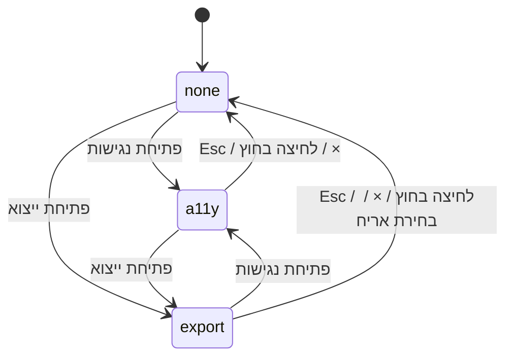
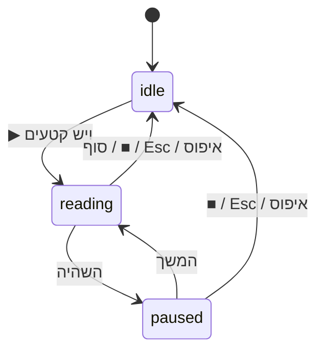
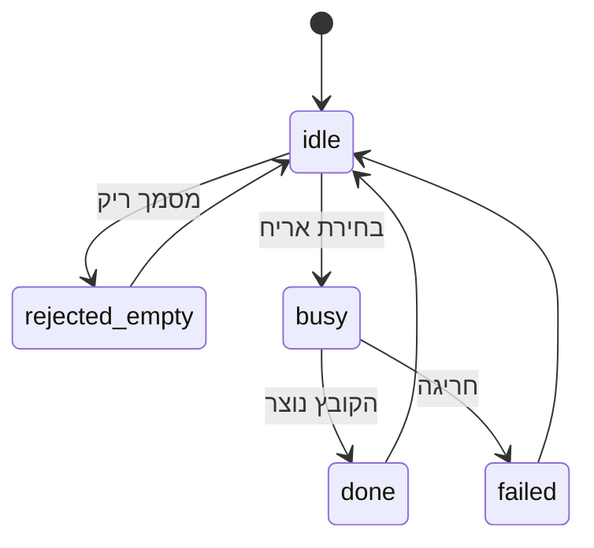
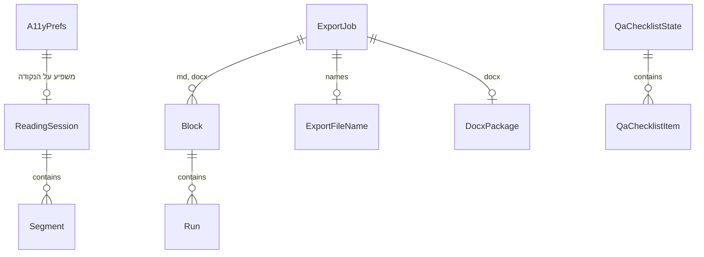

# מפרט פונקציונלי — v4.7.0 נגישות וייצוא

## מקורות

- הדרישות: `aidlc/spaces/default/intents/261101-a11y-export-v47/inception/requirements-analysis/requirements.md` (requirements)
- ‏`entities.md` ו-`rules.md` בתיקייה הזו (מקור האמת לנתונים ולכללים)
- ‏`inception/refined-mockups/` (מוקאפים ומפרט אינטראקציה)
- תשובות שלב זה: Q1 עד Q12
- הקוד הקיים: `index.html` (`parseMarkdown`, ‏`downloadFile`, ‏`showToast`, בלוקי הייצוא), ‏`md-visual-ui.js` (הדבקה, ‏Esc, ‏`releaseFocus`)

המסמך הזה הוא מקור האמת לזרימות העבודה ולמכונות המצבים. דיאגרמת הישויות וסיכום הכללים בסופו נגזרים מ-`entities.md` ומ-`rules.md`.

## 1. מבנה המודולים (Q1)

| קובץ | סוג | אחריות |
|---|---|---|
| `a11y.js` | טהור, UMD (`window.MdA11y`) | ניתוח וניקוי A11yPrefs, רמות הגודל, ‏`isDefault`, בניית קטעי הקראה מתיאור בלוקים, חישוב ניגודיות WCAG |
| `a11y-ui.js` | DOM | שני האייקונים, רכיב פאנל משותף, פאנל הנגישות, "דלג לתוכן", ‏`notify` ואזור חי, ‏`speechSynthesis`, ‏Esc גלובלי |
| `export-core.js` | טהור, UMD (`window.MdExport`) | ‏`parseBlocks`, ‏`parseRuns`, ‏`toMarkdown`, ‏`applyLrm`, ‏`fileName`, ‏`asOfDate`, ‏`buildDocx` (XML), ‏`zipStore`, ‏`crc32`, ‏`xmlEscape` |
| `export-ui.js` | DOM | פאנל הייצוא ושישה אריחים, ‏ExportJob, חיבור לפונקציות ה-HTML הקיימות, ראש ההדפסה |

הקוד הקיים ב-`index.html` שבונה HTML חי ו-HTML לצפייה בלבד עובר לפונקציות עם שם (`buildCleanHtml`, ‏`buildLiveHtml`), ו-`export-ui.js` קורא להן. הן נכתבות בפורמט שמחלץ `test-support/load-app.js` מזהה: כותרת `    function name(` בהזחה של 4 רווחים, וסגירה בשורה `    }`. כך אפשר לבדוק אותן ביחידה.

**גודל טקסט (BR7.11):** `--ax-zoom` מוגדר על `<html>`, ו-`body { zoom: var(--ax-zoom) }`. החלונות המודאליים נמצאים בתוך `body`, ולכן הם מוגדלים יחד עם המסך. היעד הוא Chromium 128 ומעלה, שבו `zoom` תקני. החלופה (rem) הוגדרה מראש ב-BR7.11. הקבצים נטענים אחרי `md-visual-ui.js` ולפני הסקריפט הראשי, ונוספים ל-`ASSETS` ב-`sw.js` ולרשימת `FILES` ב-`scripts/build-dist.js`.

## 2. זרימות עבודה

### WF1 — פתיחה וסגירה של פאנל (BR1.3, BR1.4, BR1.5)

1. המשתמש לוחץ, או מקיש Enter או Space, על אייקון.
2. אם חלון מודאלי פתוח, הבקשה נדחית (BR1.5).
3. אם הפאנל של האייקון כבר פתוח, הוא נסגר וממשיכים לצעד 8.
4. אם הפאנל האחר פתוח, הוא נסגר בלי להחזיר פוקוס.
5. `open` מקבל את ערך הפאנל, ו-`opener` את האייקון. ‏`hidden` מוסר מהפאנל, ו-`aria-expanded` הופך ל-true.
6. הפוקוס עובר לפקד הראשון בפאנל.
7. הפאנל ממתין לאחד מאירועי הסגירה: Esc, לחיצה מחוץ לפאנל ולאייקון, ×, או בחירת אריח בפאנל הייצוא.
8. בסגירה: `hidden` חוזר, ‏`aria-expanded` הופך ל-false, ‏`open` הופך ל-none, והפוקוס חוזר ל-`opener`.

### WF2 — טעינת העדפות (BR2.2, BR2.12)

1. קוראים את `mdw_theme`, ‏`mdw_a11y_hc` ו-`mdw_a11y_zoom`. אם הקריאה נכשלת, משתמשים בברירות המחדל.
2. `a11y.normalizePrefs` מחליף ערך לא חוקי בברירת המחדל.
3. מחילים: `html[data-theme]`, המחלקה `.hc` ו-`--ax-zoom`. ‏`data-theme` עובר מ-`<body>` ל-`<html>`, וכללי ה-CSS הקיימים `[data-theme="dark"]` ממשיכים לעבוד.
4. מעדכנים את הנקודה על אייקון הנגישות (BR1.6).
5. כדי למנוע הבהוב בטעינה, סקריפט קטן ב-`<head>` מחיל את `data-theme` ואת `.hc` לפני הציור הראשון.

### WF3 — שינוי העדפה (BR2.1, BR2.3, BR2.4, BR2.10, BR2.11)

1. המשתמש משנה ערכה, ניגודיות או גודל, או לוחץ איפוס.
2. מחשבים את A11yPrefs החדש (`a11y.nextZoom`, ‏`a11y.reset`).
3. מחילים על `<html>` ושומרים (שמירה שנכשלת לא עוצרת את התהליך).
4. מעדכנים את מצב ה-ARIA של הפקדים ואת הנקודה.
5. `notify(text, {announce: true})`, למשל "ערכת צבעים: לילה", "ניגודיות גבוהה הופעלה", "גודל טקסט 130%" או "הגדרות הנגישות אופסו".

### WF4 — הקראה (BR2.6, BR2.7, BR2.8, BR2.13)

1. לחיצה על ▶. אם אין `speechSynthesis`, הכפתור כבר מושבת.
2. אוספים את הבלוקים הגלויים ב-`#preview-content`. ה-UI ממיר כל בלוק לתיאור (`{kind, text, element}`), ו-`a11y.buildSegments` מחזיר רשימת קטעים.
3. אם אין קטעים: "המסמך ריק", והקריאה מסתיימת.
4. בוחרים קול `he-IL` אם יש. אם אין, ההודעה היא "לא נמצא קול עברי, ההקראה בקול ברירת המחדל".
5. `state` הופך ל-reading, הגלולה מוצגת, והודעה "ההקראה התחילה".
6. לכל קטע: מוסיפים את המחלקה `.ax-reading` לאלמנט, קוראים ל-`scrollIntoView({block: 'nearest'})` ומשמיעים `utterance`. ב-`onend` עוברים לקטע הבא.
7. השהיה: `speechSynthesis.pause()`, ו-`state` הופך ל-paused. המשך: `resume()`.
8. עצירה, דרך ■, הגלולה, Esc או איפוס: `cancel()`, הסרת ההדגשה, ‏`state` הופך ל-idle והגלולה מוסתרת. אם העצירה הייתה מהגלולה, הפוקוס עובר לאייקון הנגישות.
9. בסוף הקטעים: "ההקראה הסתיימה", ו-`state` הופך ל-idle.

### WF5 — ייצוא (BR3, BR4)

1. בחירת אריח. אם יש ExportJob במצב busy, הבחירה מתעלמת (BR4.9).
2. הפאנל נסגר והפוקוס חוזר לאייקון הייצוא (BR1.4).
3. `visualUI.flush()`: אם העורך הוויזואלי פעיל, ה-Markdown מסונכרן לפני הקריאה (BR4.1).
4. אם `mdInput.value.trim()` ריק, ההודעה היא "המסמך ריק" וזה הסוף (BR4.8).
5. `state` הופך ל-busy: ‏`aria-busy="true"`, התווית "מייצר קובץ…", האריחים מקבלים `aria-disabled`, והודעה באזור החי. אחר כך **yield** של שני `requestAnimationFrame`, כדי שהמצב יצויר ויגיע לקורא המסך לפני הבנייה הסינכרונית (BR4.6).
6. `asOf` = היום. `title` = `#doc-title`, אחריו ה-h1 הראשון, ואחר כך `md-workspace`. `fileName` = `MdExport.fileName(title, asOf, ext)`.
7. לפי הפורמט:
   - **md:** `toMarkdown(parseBlocks(src), {title, asOf})`, ואז `downloadFile(... 'text/markdown')`.
   - **docx:** `buildDocx(parseBlocks(src), {title, asOf})`, ואז `zipStore(parts)`, ואז `downloadFile(Uint8Array, ... 'application/vnd.openxmlformats-officedocument.wordprocessingml.document')`.
   - **html:** `buildCleanHtml({asOf})`, כלומר הקוד הקיים עם ראש ותאריך.
   - **live:** `buildLiveHtml({asOf})`, הקוד הקיים עם ראש ותאריך בגוף.
   - **pdf:** הודעה "בחרו 'שמירה כ-PDF' בחלון ההדפסה", עדכון ראש ההדפסה, ואז `window.print()`.
   - **pdf-file:** `buildCleanHtml({asOf, autoPrint: true, page: 'A4 portrait'})`.
   - **print:** עדכון ראש ההדפסה, ואז `window.print()`.
8. הצלחה: `state` הופך ל-done, והודעה "✓ קובץ <סוג> נוצר: <שם>" (toast ואזור חי). בהודעה שם הקובץ עטוף ב-`<bdi>`. ב-pdf וב-print `window.print()` חוסם. אחרי שהוא חוזר, המצב עובר מיד ל-idle, בלי הודעת הצלחה.
9. כישלון (חריגה): `state` הופך ל-failed, והודעה "לא הצלחנו ליצור את קובץ ה-<סוג>. נסו שוב."
10. בכל מקרה: `aria-busy` מוסר, התווית חוזרת ל"ייצוא", ו-`state` חוזר ל-idle.

`notify` עוטפת את `showToast` של האפליקציה (`index.html`, השורה שמתחילה ב-`function showToast` באזור 1812). ההגדרה השנייה באזור 2259 נמצאת בתוך תבנית ה-HTML החי ורצה רק בקובץ המיוצא, ולכן לא נוגעים בה.

### WF6 — פירוק Markdown לבלוקים (Q2, BR3.8)

1. מנרמלים סופי שורה ל-`\n`.
2. מחלצים בלוקים מגודרים (```` ``` ````) לפני כל דבר אחר. ‏`mermaid` הופך ל-diagram, וכל השאר ל-code עם `lang`.
3. עוברים שורה אחרי שורה, לפי סדר העדיפות: אזור `<div dir="...">`, כותרת `#`, קו מפריד, טבלה (שורת כותרת ושורת הפרדה עם יישור), ציטוט `>` (כולל ריבוי שורות), רשימה (`-`, ‏`+`, ‏`*`, ‏`1.`, משימות `[ ]` ו-`[x]`, קינון לפי 2 רווחים לרמה), תמונה בשורה לבד, ופסקה (שורות רצופות).
4. לכל טקסט מריצים `parseRuns`: קוד (`` ` ``) לפני הכול, אחר כך קישור `[טקסט](url)`, ‏`**`, ‏`*` או `_`, ו-`~~`. ‏`href` עובר את אותו כלל של `safeUrl` (http, ‏https, ‏mailto, עוגן ונתיב יחסי).
5. ההתנהגות תואמת ל-`parseMarkdown` בתכונות של v4.6.0. בדיקת התאמה רצה על קורפוס, ולא רק על מסמך הדוגמה: `SAMPLE_MD` של css-studio, ‏`samples/css-studio-sample.md`, ותבניות התוכן ב-`index.html`. הקורפוס כולל רשימות מקוננות, ציטוט מרובה שורות, טבלאות מיושרות, משימות ואזורי `div dir`. הבדיקה משווה לכל מסמך את רצף סוגי הבלוקים ואת טקסט הבלוקים מול פלט `parseMarkdown`, כשהמחלץ הוא `load-app.js`.

### WF7 — בניית docx (BR3.7, BR3.9, BR3.10, BR3.11, Q5; הורחב אחרי הסקירה)

#### 7.1 חלקי החבילה ויחסים

| חלק | תוכן |
|---|---|
| `[Content_Types].xml` | ‏`Default`: ‏`rels` → `application/vnd.openxmlformats-package.relationships+xml`, ‏`xml` → `application/xml`. ‏`Override`: ‏`/word/document.xml` (`…wordprocessingml.document.main+xml`), ‏`/word/styles.xml` (`…styles+xml`), ‏`/word/numbering.xml` (`…numbering+xml`), ‏`/word/settings.xml` (`…settings+xml`), ‏`/docProps/core.xml` (`application/vnd.openxmlformats-package.core-properties+xml`) |
| `_rels/.rels` | ‏`rId1` → `word/document.xml` (officeDocument), ‏`rId2` → `docProps/core.xml` (core-properties) |
| `word/_rels/document.xml.rels` | ‏`rId1` → `styles.xml`, ‏`rId2` → `numbering.xml`, ‏`rId3` → `settings.xml`, ומ-`rId10` והלאה hyperlink-ים חיצוניים (`TargetMode="External"`) |
| `docProps/core.xml` | ‏`dc:title` = כותרת המסמך. ‏`dcterms:created` ו-`dcterms:modified` = ‏`asOf` בשעה 00:00:00Z, ולא שעון אמיתי, כדי שהפלט יהיה דטרמיניסטי |
| `word/settings.xml` | ‏`w:themeFontLang w:bidi="he-IL"`, ‏`w:defaultTabStop` |

**בדיקות יחידה על החבילה:** כל חלק הוא XML תקין (מפרק פשוט בתוך הבדיקה, שבודק תגים מאוזנים). כל `Target` ב-rels מצביע לחלק שקיים בחבילה. לכל חלק `xml` שאינו rels יש `Override`. כל `r:id` ב-`document.xml` קיים ב-rels. בנוסף, `unzip -t` רץ על הקובץ כשהכלי זמין במערכת, וזו בדיקה מכלי עצמאי.

#### 7.2 גוף המסמך

1. `w:body` נפתח בכותרת המסמך (סגנון Title) ובשורה "נכון ל-<DD.MM.YYYY>", ונסגר ב-`w:sectPr`: ‏A4 לאורך (`w:pgSz w:w="11906" w:h="16838"`), שוליים של 1134 twips (2 ס״מ), ו-`w:bidi` ברמת הסקשן.
2. לכל בלוק:
   - **h1 עד h3:** סגנונות Heading1 עד Heading3. ‏h4 עד h6 ממופים ל-Heading3.
   - **p:** פסקה בסגנון Normal.
   - **list:** כל פריט הוא פסקה עם `w:numPr` (`w:ilvl` = רמה, `w:numId`). **לכל רשימה ממוספרת יש `w:num` משלה**, מעל אותו `abstractNum`, עם `w:lvlOverride`/`w:startOverride w:val="1"` לכל תשע הרמות, כדי שהמספור יתחיל מ-1 בכל רשימה. לתבליטים יש `w:num` אחד משותף. ב-`task` הרץ הראשון הוא "☐ " או "☑ ".
   - **table:** ‏`w:tbl` ← ‏`w:tblPr` (‏`w:tblStyle`?, ‏`w:bidiVisual`, ‏`w:tblW w:type="pct" w:w="5000"`, ‏`w:tblBorders`, ‏`w:tblLook`) ← ‏`w:tblGrid` עם `w:gridCol` לכל עמודה (רוחב שווה = 9638 twips חלקי מספר העמודות) ← שורות. שורה ראשונה: `w:trPr` עם `w:tblHeader`. לכל תא `w:tcPr` עם `w:tcW` (אותו רוחב). שורות קצרות מושלמות בתאים ריקים. כל תא מכיל לפחות `w:p` אחד.
   - **code:** פסקה לכל שורה בסגנון Code (Consolas ב-`ascii`/`hAnsi`/`cs`, הצללה אפורה, ‏`w:bidi w:val="0"`, ‏`w:jc w:val="left"`). בלי LRM.
   - **quote:** סגנון Quote (גבול בצד ההתחלה, הזחה בצד ההתחלה).
   - **hr:** פסקה ריקה עם `w:pBdr/w:bottom`.
   - **diagram:** פסקה קטנה "תרשים (Mermaid), קוד המקור", ואחריה בלוק code.
   - **image:** פסקה "[תמונה: <alt>]", ואם יש כתובת חיצונית, hyperlink אליה (BR3.10).
   - **dirRegion:** הבלוקים שבתוכו נבנים עם הכיוון שנכפה (‏rtl → ‏`w:bidi`, ‏ltr → ‏`w:bidi w:val="0"`).

#### 7.3 כיוון, רצים ויישור

1. **כיוון פסקה:** פסקה עם עברית מקבלת `w:bidi`. פסקה בלי עברית בכלל מקבלת `w:bidi w:val="0"` ו-`w:jc w:val="left"` (LTR מפורש, FR4.3).
2. **פיצול רצים לפי כתב:** כל `Run` מ-`parseRuns` מתפצל לתתי-רצים לפי כתב. מקטע עברי מקבל `w:rtl`. מקטע לטיני או מספרי מקבל בלי `w:rtl`. רווחים ופיסוק ניטרלי מצטרפים למקטע שלפניהם, ובתחילת פסקה למקטע שאחריהם. העיצוב (מודגש, נטוי, קו חוצה, קוד, קישור) נשמר בכל תת-רץ.
3. **מאפייני complex script:** בכל תת-רץ עם `w:rtl`, מודגש כותב גם `w:bCs` ונטוי גם `w:iCs`. בסגנונות הכותרת `w:sz` מלווה ב-`w:szCs` באותו ערך. ‏`w:rFonts` תמיד כולל `w:ascii`, ‏`w:hAnsi` ו-`w:cs` ="Arial" (בקוד: Consolas).
4. **יישור בטבלת bidi:** ב-OOXML, בפסקה עם `w:bidi`, הערכים של `w:jc` מתפרשים יחסית לכיוון. לכן יישור Markdown ממופה לערכים לוגיים: `left` ← `w:jc w:val="end"`, ‏`right` ← `w:jc w:val="start"`, ‏`center` ← `center`. בלי יישור: בלי `w:jc`. בפסקה LTR: ‏`left` ← `start` ו-`right` ← `end`. בדיקת יחידה בודקת את ארבעת הצירופים.
5. **הזחה ברשימות:** ‏`numbering.xml` משתמש ב-`w:ind w:start="<720×(ilvl+1)>" w:hanging="360"`, ערכים לוגיים שמתהפכים נכון ב-bidi. ‏`w:lvlJc w:val="start"`.
6. **LRM:** מוחל לפי BR4.3 על `text` של רצים שאינם קוד, **לפני** הפיצול לפי כתב. ה-LRM הוא תו ניטרלי, ולכן הוא מצטרף לתת-הרץ הלטיני שלידו, כך שכל זוג LRM עוטף את המקטע הלטיני בתוך אותו תת-רץ. בדיקת יחידה בודקת שאין LRM בתוך `href`, ‏`alt` או קוד.

#### 7.4 סכימה ותווים

1. **סדר אלמנטים** (נאכף בפונקציות בנייה קבועות, ונבדק בבדיקת יחידה):
   - `w:pPr`: ‏`w:pStyle`, ‏`w:numPr`, ‏`w:pBdr`, ‏`w:shd`, ‏`w:bidi`, ‏`w:jc`.
   - `w:rPr`: ‏`w:rStyle`, ‏`w:rFonts`, ‏`w:b`, ‏`w:bCs`, ‏`w:i`, ‏`w:iCs`, ‏`w:strike`, ‏`w:sz`, ‏`w:szCs`, ‏`w:rtl`.
   - `w:tblPr`: ‏`w:tblStyle`, ‏`w:bidiVisual`, ‏`w:tblW`, ‏`w:tblBorders`, ‏`w:tblLook`.
2. **`w:t`:** תמיד עם `xml:space="preserve"`, כי בטקסט יכולים להיות רווחים בקצוות ו-LRM.
3. **Escaping:** `& < > " '`, והסרת תווי בקרה שאסורים ב-XML 1.0 (BR3.11).

#### 7.5 קישורים (BR3.10, BR3.11)

- `http`, `https` ו-`mailto` שעברו `safeUrl` הופכים ל-`w:hyperlink r:id` עם קשר חיצוני, בסגנון Hyperlink.
- עוגן (`#...`) ונתיב יחסי: **טקסט בלבד**, בלי קישור. נתיב יחסי לא נפתח מחוץ לאפליקציה, ולעוגן אין bookmark ב-docx. ההחלטה נרשמת ב-BACKLOG כהגבלה.
- כתובת ש-`safeUrl` דוחה: טקסט בלבד.

#### 7.6 ZIP

`zipStore`: לכל קובץ local header, הנתונים ו-central directory, ובסוף end record. ‏CRC32 לפי פולינום ‎0xEDB88320. שמות הקבצים ב-UTF-8 עם דגל ‎0x0800. תאריך ושעה DOS קבועים. ‏`[Content_Types].xml` הוא הרשומה הראשונה. הפלט דטרמיניסטי: אותו קלט ואותו `asOf` נותנים אותם בתים.

### WF8 — הדבקה בעורך הוויזואלי (BR5.1, BR5.2; תוקן אחרי הסקירה)

ההדבקה הקיימת (`md-visual-ui.js`, מאזין `paste`) כבר מבטלת את ברירת המחדל ומכניסה טקסט פשוט דרך `execCommand`. ענפי ההדבקה הקיימים נשמרים כמו שהם, כדי שלא תהיה נסיגה מ-v4.6.0:
- **תא, פריט רשימה או כותרת:** שורה אחת ב-`insertText`, אחרי כיווץ שורות חדשות.
- **גוף:** `V.plainTextToHtml` ואחריו `insertHTML`, כדי לשמור פסקאות.

1. `paste`: ‏`preventDefault()`. הטקסט הוא `text/plain`. הענף נבחר כמו היום.
2. **לפני** ה-`exec`: צילום סינכרוני של קבוצת ה-`span[style]` שכבר קיימים בעורך (`Set` של אלמנטים).
3. `exec` של הענף. זה צעד ביטול אחד בדפדפן.
4. **מיד אחרי** ה-`exec`, באותו טיק: אוספים את `span[style]` שלא היו בצילום. אין `MutationObserver`, ולכן אין בעיית אסינכרוניות.
5. **אם לא נוספו `span[style]`**, לא נוגעים ב-DOM, והביטול (Ctrl/Cmd+Z) נשאר שלם. זה המקרה הצפוי ב-`insertText`.
6. **אם נוספו**, מנקים רק אותם (R-06). הניקוי הוא שינוי DOM מחוץ ל-`execCommand`, ולכן ב-Chromium הוא עלול לפגוע בביטול. בדיקת e2e מכסה הדבקה בגוף, בתא ובפריט רשימה, ואחריה Ctrl+Z ו-Ctrl+Shift+Z ב-Chromium. אם הבדיקה מראה שבגוף נוצרים span-ים והביטול נפגע, R-07 נרשם כמגבלה ידועה ב-BACKLOG, עם התוצאה המדויקת. Firefox מחוץ להיקף הגרסה (requirements, אילוצים).

`unwrapPastedSpans` מקבלת רשימת אלמנטים ולא סורקת את כל העורך (R-06).

## 3. מכונות מצבים

### SM1 — PanelState



טקסט חלופי: מ-none לכל אחד מהפאנלים. בין הפאנלים מעבר ישיר. חזרה ל-none בכל אירוע סגירה, ובפאנל הייצוא גם בבחירת אריח.

### SM2 — ReadingSession



טקסט חלופי: idle עובר ל-reading רק כשיש קטעים. reading ו-paused מתחלפים ביניהם, ושניהם חוזרים ל-idle בעצירה. reading חוזר ל-idle גם בסוף הקטעים.

### SM3 — ExportJob



טקסט חלופי: מסמך ריק נדחה מיד. אחרת busy, ומשם הצלחה או כישלון, ותמיד חזרה ל-idle.

## 4. מקרי קצה

| מקרה | התנהגות | כלל |
|---|---|---|
| ‏`localStorage` חסום | ההעדפות פועלות בזיכרון בלבד | BR2.12 |
| ערך שמור לא חוקי (למשל `mdw_a11y_zoom=999`) | ברירת מחדל | BR2.2 |
| כותרת רק מתווים אסורים | `md-workspace-<תאריך>` | BR4.4 |
| כותרת ארוכה מ-80 תווים | חיתוך ל-80, בלי לשבור צמד surrogate | BR4.4 |
| פסקה באנגלית בלבד | LTR מפורש, בלי LRM | BR4.3 |
| LRM שכבר קיים בטקסט | לא מוסיפים כפול | BR4.3 |
| תו בקרה לא חוקי ב-XML | מוסר | BR3.11 |
| קישור `javascript:` | הטקסט נשאר, הקישור מושמט | BR3.10, BR3.11 |
| טבלה עם מספר תאים שונה בשורות | משלימים בתאים ריקים | BR3.7 |
| שני קליקים מהירים על אריחים | השני מתעלם | BR4.9 |
| Esc בזמן IME | אין פעולה | BR2.13, BR5.4 |
| חלון מודאלי פתוח | הפאנלים לא נפתחים | BR1.5 |
| דפדפן בלי `speechSynthesis` | ▶ מושבת עם הסבר | BR2.8 |

## 5. נגזרות לקריאה

### דיאגרמת ישויות (נגזרת מ-entities.md)



טקסט חלופי: להעדפות יש לכל היותר הקראה אחת. בהקראה יש קטעים. לייצוא יש בלוקים (ב-md וב-docx), שם קובץ וחבילת docx. בבלוק יש רצים. ברשימת ה-QA יש פריטים.

### סיכום כללים (נגזר מ-rules.md)

| קבוצה | עיקר |
|---|---|
| BR1 | שני אייקונים, פאנל אחד, סגירה וחזרת פוקוס, חלון מודאלי גובר, נקודת שינוי |
| BR2 | ערכה, ניגודיות, חמש רמות, היקף ההשפעה, קטעי הקראה, עצירה, מקרי קצה, דילוג, איפוס, אזור חי, שמירה, סדר Esc |
| BR3 | שישה אריחים, PDF וגיבוי, HTML בלי סקריפטים, HTML חי, הדפסה, MD עטוף, docx, תוכן זהה, תרשים, תמונה, escaping |
| BR4 | היקף, ראש ותאריך, LRM, שם קובץ, דחייה אינה שגיאה, busy, שגיאה, ריק, ייצוא אחד |
| BR5 | R-06 עד R-10 |
| BR6 | רשימת QA |
| BR7 | ניגודיות, reflow, מקלדת, תנועה, טוקנים, ביצועים, offline, תאימות, יכולת בדיקה, תקן, ‏zoom |

## נספח A — מקרי בדיקה ל-LRM (BR4.3)

`‎` מסמן כאן את U+200E.

| # | קלט (יחידת טקסט) | פלט | הסבר |
|---|---|---|---|
| 1 | `השלב 3.5 Code Generation מייצר קוד` | `השלב ‎3.5 Code Generation‎ מייצר קוד` | רווח יחיד בין מילים לטיניות מחבר אותן לביטוי אחד |
| 2 | `משתמשים ב-API.` | `משתמשים ב-‎API‎.` | מקף הקידומת והנקודה בסוף לא נכללים |
| 3 | `גרסה v4.7.0 שוחררה` | `גרסה ‎v4.7.0‎ שוחררה` | נקודות פנימיות נכללות |
| 4 | `ראו (README.md) למעלה` | `ראו (‎README.md‎) למעלה` | הסוגריים לא נכללים |
| 5 | `Code Generation` | `Code Generation`, ללא שינוי, והיחידה מקבלת LTR מפורש | אין עברית ביחידה |
| 6 | `השלב ‎3.5‎ פעיל` | ללא שינוי | אידמפוטנטי |
| 7 | `קישור [מדריך](https://x.y/a)` | ה-`href` ללא LRM. טקסט הקישור עברי, ולכן אין שינוי | ה-LRM לא חל על `href` |
| 8 | `` הפקודה `npm test` רצה `` | ללא שינוי ברץ הקוד | ה-LRM לא חל על קוד |
| 9 | `נכון ל-01.11.2026` | `נכון ל-‎01.11.2026‎` | ביטוי מספרי עם נקודות |

## 6. חריגות מתועדות

- **A4 לאורך** ב-Word וב-PDF, במקום "לרוחב" שבהנחיות (Q6). ‏FR3.3 ו-FR3.8 בדרישות עודכנו.
- **תרשימים ב-Word** מוצגים כקוד מקור (Q3), ותמונות כקישור (Q4). שתי ההגבלות יירשמו ב-BACKLOG.
- **‏`aria-checked` במתג** במקום `aria-pressed` (נקבע ב-Requirements, ‏FR2.3).
- **קישורי עוגן ונתיב יחסי ב-Word** נשארים טקסט בלבד (WF7.5). יירשם ב-BACKLOG.
- **R-07** עלול להישאר מגבלה ידועה, אם בדיקת ה-e2e תראה שבהדבקה בגוף Chromium יוצר `span[style]` (WF8, שלב 6).
