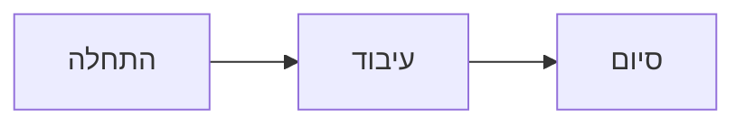

# כותרת ראשית — מדריך עיצוב (H1)

> ציטוט: כך נראה בלוק ציטוט במסמך. אפשר לעצב צבע, רקע וקו צד.

## כותרת רמה 2 (H2)

זו פסקה רגילה עם **טקסט מודגש**, *טקסט נטוי* ו-`קוד בתוך שורה`. הפסקה ממשיכה בשורה הבאה
כדי להדגים ריווח בין שורות ושבירת שורה.

### כותרת רמה 3 (H3)
#### כותרת רמה 4 (H4)
##### כותרת רמה 5 (H5)
###### כותרת רמה 6 (H6)

## רשימות

* פריט ראשון ברשימת תבליטים
* פריט שני עם **הדגשה**
* פריט שלישי

1. שלב ראשון
2. שלב שני
3. שלב שלישי

## טבלה

| עמודה א | עמודה ב | עמודה ג |
| --- | --- | --- |
| שורה 1 | ערך | ערך |
| שורה 2 | ערך | ערך |
| שורה 3 | ערך | ערך |

## בלוק קוד

```js
function hello(name) {
  return 'שלום ' + name;
}
```

## תרשים



## אזורי כיוון

כיוון הפסקה נקבע אוטומטית לפי השפה: פסקה בעברית נשארת מימין לשמאל, גם כשיש בה מונחים באנגלית כמו API ו-JSON.

This plain English paragraph has no wrapper, so it is laid out from left to right automatically.

<div dir="rtl">
זו פסקה בתוך אזור ימין-לשמאל, עם `קוד` ו**הדגשה**.

* פריט בתוך האזור
</div>

<div dir="ltr">
This paragraph sits inside a left-to-right block, with `inline code` and **bold** text.

* An item inside the block
</div>

פסקה אחרונה מחוץ לאזורי הכיוון.
